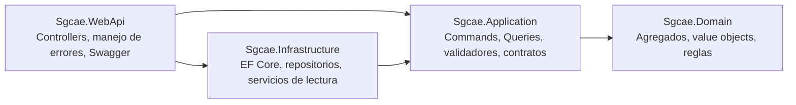
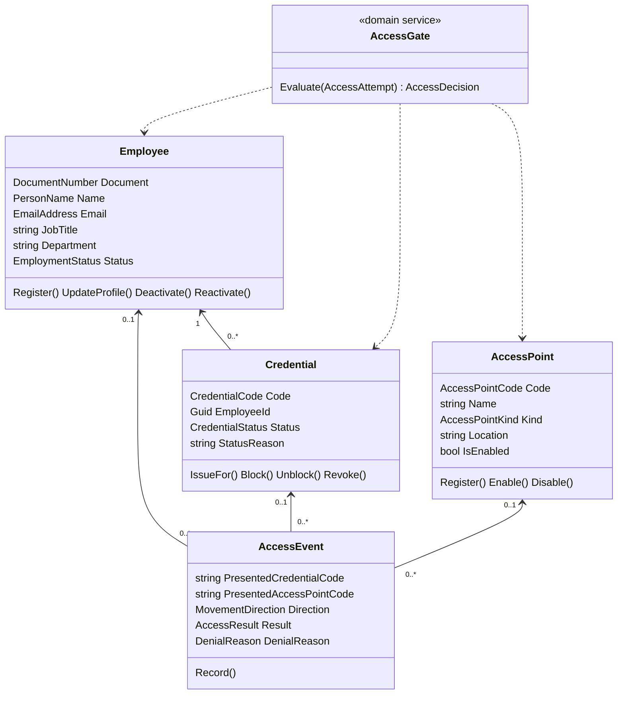
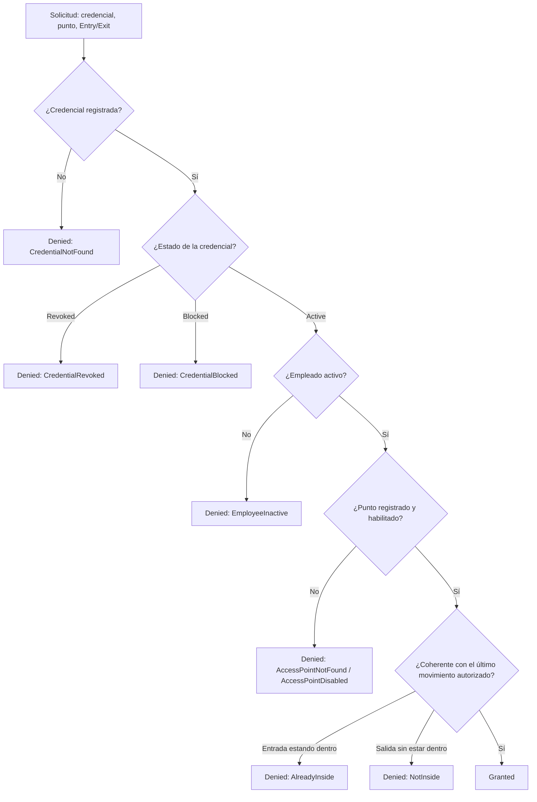

# SGCAE · Sistema de Gestión y Control de Acceso de Empleados

Backend REST para administrar los empleados de una empresa de logística, sus credenciales,
los puntos de acceso físicos y el registro de entradas y salidas, con historial consultable.

Construido con **ASP.NET Core 8 Web API**, **Entity Framework Core 8** sobre **SQL Server**,
siguiendo **Clean Architecture**, **DDD** y **CQRS** (MediatR + FluentValidation).

## Requerimientos cubiertos

| RF | Descripción | Endpoints |
|---|---|---|
| RF-01 | Gestión de empleados: registrar, consultar, actualizar, desactivar (y reactivar) | `/api/employees` |
| RF-02 | Gestión de credenciales: asignar, consultar estado, bloquear, desbloquear y revocar | `/api/employees/{id}/credentials`, `/api/credentials` |
| RF-03 | Registro de entradas y salidas, incluidos los intentos rechazados | `POST /api/access-events` |
| RF-04 | Historial por empleado, rango de fechas, punto de acceso y resultado, paginado | `GET /api/access-history` |
| RF-06 | Administración de puntos de acceso habilitados/deshabilitados | `/api/access-points` |

## Arquitectura



Las dependencias apuntan hacia el dominio: `Sgcae.Domain` no referencia ningún otro proyecto ni paquete.

| Proyecto | Responsabilidad |
|---|---|
| `Sgcae.Domain` | Agregados (`Employee`, `Credential`, `AccessPoint`, `AccessEvent`), value objects (`DocumentNumber`, `PersonName`, `EmailAddress`, `CredentialCode`, `AccessPointCode`) y el servicio de dominio `AccessGate`. |
| `Sgcae.Application` | Casos de uso como slices verticales: cada archivo reúne el comando o consulta, su validador y su handler. Define los contratos que implementa la infraestructura. |
| `Sgcae.Infrastructure` | `SgcaeDbContext` (también es la unidad de trabajo), configuraciones de EF Core, migraciones, repositorios y servicios de lectura. |
| `Sgcae.WebApi` | Controllers delgados que solo envían mensajes por MediatR, traducción de excepciones a `problem+json` y Swagger. |
| `Sgcae.UnitTests` | Pruebas del dominio y de las validaciones (xUnit). |

### CQRS

- **Comandos** (`ICommand`): cargan el agregado con su repositorio, ejecutan el método de dominio y confirman con `IUnitOfWork`.
- **Consultas** (`IQuery`): pasan por servicios de lectura (`I*ReadService`) que consultan con `AsNoTracking`
  y devuelven DTOs, sin tocar los agregados.
- `ValidationBehavior` valida cada mensaje con FluentValidation antes de llegar al handler.

## Modelo de dominio



### Reglas e invariantes

- La identificación y el correo del empleado son únicos; la identificación no se puede modificar.
- Un empleado inactivo no se puede editar ni recibir credenciales.
- Las credenciales tienen código `SGC-XXXX-XXXX`, generado con un generador criptográfico y sin caracteres ambiguos (I, O, 0, 1).
- Un empleado tiene **como máximo una credencial vigente** (activa o bloqueada). Lo valida el caso de uso y lo respalda
  un índice único filtrado en SQL Server (`UX_Credentials_EmployeeId_Current`).
- Estados de la credencial: `Active ⇄ Blocked → Revoked`. Bloquear y revocar exigen un motivo; una credencial revocada no admite cambios.
- Los puntos de acceso nacen habilitados; solo los habilitados autorizan movimientos.

### Regla de acceso (RF-03)

`AccessGate` evalúa en este orden y devuelve el primer motivo de rechazo:



Todos los intentos, autorizados o rechazados, quedan guardados en `AccessEvents` con los códigos tal como se presentaron.
La última regla (anti-passback) impide registrar dos entradas seguidas o una salida sin entrada.

## Cómo ejecutarlo

Requisitos: [.NET SDK 8](https://dotnet.microsoft.com/download/dotnet/8.0) y SQL Server.
La forma más simple de tener SQL Server es Docker:

```bash
docker compose up -d          # SQL Server 2022 en localhost:1433
dotnet run --project src/Sgcae.WebApi
```

Abra <http://localhost:5180/swagger>. En el entorno `Development` la API aplica las migraciones al iniciar
(`Database:MigrateOnStartup`). La cadena de conexión está en `src/Sgcae.WebApi/appsettings.json`
(`ConnectionStrings:Sgcae`); cámbiela si usa otra instancia de SQL Server.

Para aplicar las migraciones manualmente:

```bash
dotnet tool restore
dotnet ef database update --project src/Sgcae.Infrastructure --startup-project src/Sgcae.WebApi
```

Pruebas unitarias:

```bash
dotnet test
```

## Probar la API

La carpeta [`http/`](http) tiene un archivo `.http` por requerimiento (se ejecutan desde Visual Studio, Rider o la
extensión REST Client de VS Code), en el orden sugerido:

1. `01-puntos-de-acceso.http`
2. `02-empleados.http`
3. `03-credenciales.http`
4. `04-entradas-y-salidas.http`
5. `05-historial.http`

Los errores se devuelven como `application/problem+json`:

| Código | Cuándo |
|---|---|
| 400 | Datos inválidos (incluye el detalle por campo) |
| 404 | El recurso no existe |
| 409 | Valor duplicado o credencial vigente existente |
| 422 | Se incumple una regla de negocio (incluye `code`, por ejemplo `credential_revoked`) |

Las listas devuelven `items`, `page`, `pageSize`, `totalCount`, `totalPages`, `hasPreviousPage` y `hasNextPage`;
el tamaño de página máximo es 100.

## Flujo de trabajo en Git

- `main`: versiones publicadas.
- `develop`: integración.
- `feature/*`: una rama por requerimiento, integrada a `develop` con merge commit.
