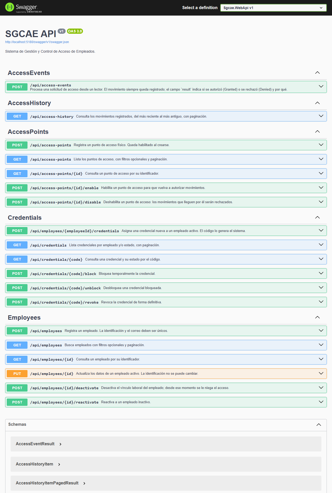

# Evidencias de funcionamiento

Ejecución de punta a punta de la API contra SQL Server 2022 (Docker), sobre una base de datos vacía,
recorriendo los requerimientos RF-06, RF-01, RF-02, RF-03 y RF-04 en ese orden.
Las mismas peticiones están en la carpeta [`http/`](../http) para repetirlas.
Resultado: **41 de 41 pasos con el resultado esperado.**

| # | Paso | Petición | HTTP |
|---|---|---|---|
| 1 | Registrar recepción | `POST /api/access-points` | 201 ✅ |
| 2 | Registrar bodega | `POST /api/access-points` | 201 ✅ |
| 3 | Código de punto repetido | `POST /api/access-points` | 409 ✅ |
| 4 | Deshabilitar bodega | `POST /api/access-points/9b982161-7843-48ef-914c-2f9883ecc255/disable` | 204 ✅ |
| 5 | Listar puntos habilitados | `GET /api/access-points?isEnabled=true` | 200 ✅ |
| 6 | Registrar empleada | `POST /api/employees` | 201 ✅ |
| 7 | Registrar empleado | `POST /api/employees` | 201 ✅ |
| 8 | Identificación repetida | `POST /api/employees` | 409 ✅ |
| 9 | Datos inválidos | `POST /api/employees` | 400 ✅ |
| 10 | Buscar por nombre | `GET /api/employees?search=laura` | 200 ✅ |
| 11 | Buscar por identificación | `GET /api/employees?search=71234567` | 200 ✅ |
| 12 | Actualizar cargo | `PUT /api/employees/d846b7a7-2670-4d07-b0f8-90f050d1f224` | 200 ✅ |
| 13 | Paginación de empleados | `GET /api/employees?page=1&pageSize=1` | 200 ✅ |
| 14 | Asignar credencial a Laura | `POST /api/employees/d846b7a7-2670-4d07-b0f8-90f050d1f224/credentials` | 201 ✅ |
| 15 | Segunda credencial vigente | `POST /api/employees/d846b7a7-2670-4d07-b0f8-90f050d1f224/credentials` | 409 ✅ |
| 16 | Asignar credencial a Andrés | `POST /api/employees/f4e417ce-ebd6-434f-a2f0-2ddc7b5a424e/credentials` | 201 ✅ |
| 17 | Consultar credencial por código | `GET /api/credentials/sgc-ykat-lnvt` | 200 ✅ |
| 18 | Bloquear credencial | `POST /api/credentials/SGC-YKAT-LNVT/block` | 200 ✅ |
| 19 | Entrada con credencial bloqueada | `POST /api/access-events` | 201 ✅ |
| 20 | Desbloquear credencial | `POST /api/credentials/SGC-YKAT-LNVT/unblock` | 200 ✅ |
| 21 | Entrada autorizada | `POST /api/access-events` | 201 ✅ |
| 22 | Segunda entrada sin salida | `POST /api/access-events` | 201 ✅ |
| 23 | Entrada por punto deshabilitado | `POST /api/access-events` | 201 ✅ |
| 24 | Salida autorizada | `POST /api/access-events` | 201 ✅ |
| 25 | Salida sin entrada | `POST /api/access-events` | 201 ✅ |
| 26 | Credencial desconocida | `POST /api/access-events` | 201 ✅ |
| 27 | Tipo de movimiento inválido | `POST /api/access-events` | 400 ✅ |
| 28 | Desactivar a Andrés | `POST /api/employees/f4e417ce-ebd6-434f-a2f0-2ddc7b5a424e/deactivate` | 204 ✅ |
| 29 | Entrada de empleado inactivo | `POST /api/access-events` | 201 ✅ |
| 30 | Editar empleado inactivo | `PUT /api/employees/f4e417ce-ebd6-434f-a2f0-2ddc7b5a424e` | 422 ✅ |
| 31 | Revocar credencial de Andrés | `POST /api/credentials/SGC-6ZSQ-EMQR/revoke` | 200 ✅ |
| 32 | Desbloquear credencial revocada | `POST /api/credentials/SGC-6ZSQ-EMQR/unblock` | 422 ✅ |
| 33 | Reactivar a Andrés | `POST /api/employees/f4e417ce-ebd6-434f-a2f0-2ddc7b5a424e/reactivate` | 204 ✅ |
| 34 | Nueva credencial tras revocar | `POST /api/employees/f4e417ce-ebd6-434f-a2f0-2ddc7b5a424e/credentials` | 201 ✅ |
| 35 | Historial completo | `GET /api/access-history?pageSize=50` | 200 ✅ |
| 36 | Historial de Laura | `GET /api/access-history?employeeId=d846b7a7-2670-4d07-b0f8-90f050d1f224` | 200 ✅ |
| 37 | Solo rechazados | `GET /api/access-history?result=Denied` | 200 ✅ |
| 38 | Por punto y rango de fechas | `GET /api/access-history?accessPointId=e12f6a4b-e265-48c2-b900-63a00a9e63e5&result=Granted&from=2026-01-01T00:00:00Z&to=2030-01-01T00:00:00Z` | 200 ✅ |
| 39 | Paginación del historial | `GET /api/access-history?page=2&pageSize=3` | 200 ✅ |
| 40 | Rango invertido | `GET /api/access-history?from=2026-12-31T00:00:00Z&to=2026-01-01T00:00:00Z` | 400 ✅ |
| 41 | Tamaño de página excesivo | `GET /api/access-history?pageSize=500` | 400 ✅ |

## Documentación de la API (Swagger)

Disponible en `http://localhost:5180/swagger` al ejecutar la API en el entorno Development.



## Datos persistidos en SQL Server

Consultas ejecutadas directamente sobre la base de datos `Sgcae` al terminar la prueba.

### Tablas creadas por la migración

| Esquema | Tabla | Filas |
|---|---|---|
| sgcae|__EFMigrationsHistory|1 |
| sgcae|AccessEvents|8 |
| sgcae|AccessPoints|2 |
| sgcae|Credentials|3 |
| sgcae|Employees|2 |

### sgcae.Employees

| DocumentNumber | Nombre | Email | Department | Status |
|---|---|---|---|---|
| 1036789456|Laura Marcela Gómez Restrepo|laura.gomez@logistica.com|Bodega|Active |
| 71234567|Andrés Ríos Cardona|andres.rios@logistica.com|Seguridad|Active |

### sgcae.Credentials

| Code | Empleado | Status | StatusReason |
|---|---|---|---|
| SGC-YKAT-LNVT|Laura Marcela Gómez Restrepo|Active| — |
| SGC-6ZSQ-EMQR|Andrés Ríos Cardona|Revoked|Retiro |
| SGC-K37K-KNPK|Andrés Ríos Cardona|Active| — |

### sgcae.AccessEvents

| OccurredAt (UTC) | Credencial | Punto | Direction | Result | DenialReason |
|---|---|---|---|---|---|
| 2026-10-31 05:45:38.652|SGC-YKAT-LNVT|REC-01|Entry|Denied|CredentialBlocked |
| 2026-10-31 05:45:38.731|SGC-YKAT-LNVT|REC-01|Entry|Granted| — |
| 2026-10-31 05:45:38.743|SGC-YKAT-LNVT|REC-01|Entry|Denied|AlreadyInside |
| 2026-10-31 05:45:38.752|SGC-6ZSQ-EMQR|BOD-01|Entry|Denied|AccessPointDisabled |
| 2026-10-31 05:45:38.762|SGC-YKAT-LNVT|REC-01|Exit|Granted| — |
| 2026-10-31 05:45:38.774|SGC-YKAT-LNVT|REC-01|Exit|Denied|NotInside |
| 2026-10-31 05:45:38.783|SGC-ZZZZ-ZZZZ|REC-01|Entry|Denied|CredentialNotFound |
| 2026-10-31 05:45:38.812|SGC-6ZSQ-EMQR|REC-01|Entry|Denied|EmployeeInactive |

### Índice que garantiza una sola credencial vigente por empleado

| Índice | Único | Filtro |
|---|---|---|
| UX_Credentials_EmployeeId_Current|1|([Status]<>'Revoked') |

## Detalle de cada petición

### 1. Registrar recepción

`POST /api/access-points` → **201**

```json
{
  "code": "REC-01",
  "name": "Recepción principal",
  "kind": "Reception",
  "location": "Sede principal, piso 1"
}
```

Respuesta:

```json
{
  "id": "e12f6a4b-e265-48c2-b900-63a00a9e63e5",
  "code": "REC-01",
  "name": "Recepción principal",
  "kind": "Reception",
  "location": "Sede principal, piso 1",
  "isEnabled": true,
  "registeredAt": "2026-10-31T05:45:37.9801462+00:00"
}
```

### 2. Registrar bodega

`POST /api/access-points` → **201**

```json
{
  "code": "BOD-01",
  "name": "Bodega de despachos",
  "kind": "Warehouse",
  "location": "Bloque B"
}
```

Respuesta:

```json
{
  "id": "9b982161-7843-48ef-914c-2f9883ecc255",
  "code": "BOD-01",
  "name": "Bodega de despachos",
  "kind": "Warehouse",
  "location": "Bloque B",
  "isEnabled": true,
  "registeredAt": "2026-10-31T05:45:38.1479896+00:00"
}
```

### 3. Código de punto repetido

`POST /api/access-points` → **409**

```json
{
  "code": "rec-01",
  "name": "Otra",
  "kind": "Reception",
  "location": "Piso 2"
}
```

Respuesta:

```json
{
  "title": "La operación entra en conflicto con los datos actuales.",
  "status": 409,
  "detail": "Ya existe un punto de acceso con el código REC-01.",
  "instance": "/api/access-points"
}
```

### 4. Deshabilitar bodega

`POST /api/access-points/9b982161-7843-48ef-914c-2f9883ecc255/disable` → **204**

### 5. Listar puntos habilitados

`GET /api/access-points?isEnabled=true` → **200**

Respuesta:

```json
{
  "items": [
    {
      "id": "e12f6a4b-e265-48c2-b900-63a00a9e63e5",
      "code": "REC-01",
      "name": "Recepción principal",
      "kind": "Reception",
      "location": "Sede principal, piso 1",
      "isEnabled": true,
      "registeredAt": "2026-10-31T05:45:37.9801462+00:00"
    }
  ],
  "page": 1,
  "pageSize": 20,
  "totalCount": 1,
  "totalPages": 1,
  "hasPreviousPage": false,
  "hasNextPage": false
}
```

### 6. Registrar empleada

`POST /api/employees` → **201**

```json
{
  "documentNumber": "1036789456",
  "firstNames": "Laura Marcela",
  "lastNames": "Gómez Restrepo",
  "email": "Laura.Gomez@Logistica.com",
  "jobTitle": "Analista de inventarios",
  "department": "Bodega"
}
```

Respuesta:

```json
{
  "id": "d846b7a7-2670-4d07-b0f8-90f050d1f224",
  "documentNumber": "1036789456",
  "firstNames": "Laura Marcela",
  "lastNames": "Gómez Restrepo",
  "fullName": "Laura Marcela Gómez Restrepo",
  "email": "laura.gomez@logistica.com",
  "jobTitle": "Analista de inventarios",
  "department": "Bodega",
  "status": "Active",
  "registeredAt": "2026-10-31T05:45:38.2935546+00:00",
  "deactivatedAt": null
}
```

### 7. Registrar empleado

`POST /api/employees` → **201**

```json
{
  "documentNumber": "71234567",
  "firstNames": "Andrés",
  "lastNames": "Ríos Cardona",
  "email": "andres.rios@logistica.com",
  "jobTitle": "Coordinador de seguridad",
  "department": "Seguridad"
}
```

Respuesta:

```json
{
  "id": "f4e417ce-ebd6-434f-a2f0-2ddc7b5a424e",
  "documentNumber": "71234567",
  "firstNames": "Andrés",
  "lastNames": "Ríos Cardona",
  "fullName": "Andrés Ríos Cardona",
  "email": "andres.rios@logistica.com",
  "jobTitle": "Coordinador de seguridad",
  "department": "Seguridad",
  "status": "Active",
  "registeredAt": "2026-10-31T05:45:38.3673418+00:00",
  "deactivatedAt": null
}
```

### 8. Identificación repetida

`POST /api/employees` → **409**

```json
{
  "documentNumber": "1036789456",
  "firstNames": "Otra",
  "lastNames": "Persona",
  "email": "otra@logistica.com",
  "jobTitle": "Auxiliar",
  "department": "Bodega"
}
```

Respuesta:

```json
{
  "title": "La operación entra en conflicto con los datos actuales.",
  "status": 409,
  "detail": "Ya existe un empleado con la identificación 1036789456.",
  "instance": "/api/employees"
}
```

### 9. Datos inválidos

`POST /api/employees` → **400**

```json
{
  "documentNumber": "",
  "firstNames": "",
  "lastNames": "X",
  "email": "no-es-correo",
  "jobTitle": "A",
  "department": "B"
}
```

Respuesta:

```json
{
  "title": "La solicitud tiene datos inválidos.",
  "status": 400,
  "instance": "/api/employees",
  "errors": {
    "documentNumber": [
      "'documentNumber' no debería estar vacío."
    ],
    "firstNames": [
      "'firstNames' no debería estar vacío."
    ],
    "email": [
      "'email' no es una dirección de correo electrónico válida."
    ]
  }
}
```

### 10. Buscar por nombre

`GET /api/employees?search=laura` → **200**

Respuesta:

```json
{
  "items": [
    {
      "id": "d846b7a7-2670-4d07-b0f8-90f050d1f224",
      "documentNumber": "1036789456",
      "fullName": "Laura Marcela Gómez Restrepo",
      "email": "laura.gomez@logistica.com",
      "jobTitle": "Analista de inventarios",
      "department": "Bodega",
      "status": "Active"
    }
  ],
  "page": 1,
  "pageSize": 20,
  "totalCount": 1,
  "totalPages": 1,
  "hasPreviousPage": false,
  "hasNextPage": false
}
```

### 11. Buscar por identificación

`GET /api/employees?search=71234567` → **200**

Respuesta:

```json
{
  "items": [
    {
      "id": "f4e417ce-ebd6-434f-a2f0-2ddc7b5a424e",
      "documentNumber": "71234567",
      "fullName": "Andrés Ríos Cardona",
      "email": "andres.rios@logistica.com",
      "jobTitle": "Coordinador de seguridad",
      "department": "Seguridad",
      "status": "Active"
    }
  ],
  "page": 1,
  "pageSize": 20,
  "totalCount": 1,
  "totalPages": 1,
  "hasPreviousPage": false,
  "hasNextPage": false
}
```

### 12. Actualizar cargo

`PUT /api/employees/d846b7a7-2670-4d07-b0f8-90f050d1f224` → **200**

```json
{
  "firstNames": "Laura Marcela",
  "lastNames": "Gómez Restrepo",
  "email": "laura.gomez@logistica.com",
  "jobTitle": "Líder de inventarios",
  "department": "Bodega"
}
```

Respuesta:

```json
{
  "id": "d846b7a7-2670-4d07-b0f8-90f050d1f224",
  "documentNumber": "1036789456",
  "firstNames": "Laura Marcela",
  "lastNames": "Gómez Restrepo",
  "fullName": "Laura Marcela Gómez Restrepo",
  "email": "laura.gomez@logistica.com",
  "jobTitle": "Líder de inventarios",
  "department": "Bodega",
  "status": "Active",
  "registeredAt": "2026-10-31T05:45:38.2935546+00:00",
  "deactivatedAt": null
}
```

### 13. Paginación de empleados

`GET /api/employees?page=1&pageSize=1` → **200**

Respuesta:

```json
{
  "items": [
    {
      "id": "d846b7a7-2670-4d07-b0f8-90f050d1f224",
      "documentNumber": "1036789456",
      "fullName": "Laura Marcela Gómez Restrepo",
      "email": "laura.gomez@logistica.com",
      "jobTitle": "Líder de inventarios",
      "department": "Bodega",
      "status": "Active"
    }
  ],
  "page": 1,
  "pageSize": 1,
  "totalCount": 2,
  "totalPages": 2,
  "hasPreviousPage": false,
  "hasNextPage": true
}
```

### 14. Asignar credencial a Laura

`POST /api/employees/d846b7a7-2670-4d07-b0f8-90f050d1f224/credentials` → **201**

Respuesta:

```json
{
  "id": "4a2ee41e-5b2d-4136-b64b-f6dae8f55082",
  "code": "SGC-YKAT-LNVT",
  "employeeId": "d846b7a7-2670-4d07-b0f8-90f050d1f224",
  "employeeName": "Laura Marcela Gómez Restrepo",
  "status": "Active",
  "isUsable": true,
  "issuedAt": "2026-10-31T05:45:38.4999801+00:00",
  "statusChangedAt": null,
  "statusReason": null
}
```

### 15. Segunda credencial vigente

`POST /api/employees/d846b7a7-2670-4d07-b0f8-90f050d1f224/credentials` → **409**

Respuesta:

```json
{
  "title": "La operación entra en conflicto con los datos actuales.",
  "status": 409,
  "detail": "El empleado ya tiene una credencial vigente; revóquela antes de asignarle una nueva.",
  "instance": "/api/employees/d846b7a7-2670-4d07-b0f8-90f050d1f224/credentials"
}
```

### 16. Asignar credencial a Andrés

`POST /api/employees/f4e417ce-ebd6-434f-a2f0-2ddc7b5a424e/credentials` → **201**

Respuesta:

```json
{
  "id": "9108c0ae-4a09-403e-9291-71236fa5ce2f",
  "code": "SGC-6ZSQ-EMQR",
  "employeeId": "f4e417ce-ebd6-434f-a2f0-2ddc7b5a424e",
  "employeeName": "Andrés Ríos Cardona",
  "status": "Active",
  "isUsable": true,
  "issuedAt": "2026-10-31T05:45:38.5786499+00:00",
  "statusChangedAt": null,
  "statusReason": null
}
```

### 17. Consultar credencial por código

`GET /api/credentials/sgc-ykat-lnvt` → **200**

Respuesta:

```json
{
  "id": "4a2ee41e-5b2d-4136-b64b-f6dae8f55082",
  "code": "SGC-YKAT-LNVT",
  "employeeId": "d846b7a7-2670-4d07-b0f8-90f050d1f224",
  "employeeName": "Laura Marcela Gómez Restrepo",
  "status": "Active",
  "isUsable": true,
  "issuedAt": "2026-10-31T05:45:38.4999801+00:00",
  "statusChangedAt": null,
  "statusReason": null
}
```

### 18. Bloquear credencial

`POST /api/credentials/SGC-YKAT-LNVT/block` → **200**

```json
{
  "reason": "Reporte de pérdida"
}
```

Respuesta:

```json
{
  "id": "4a2ee41e-5b2d-4136-b64b-f6dae8f55082",
  "code": "SGC-YKAT-LNVT",
  "employeeId": "d846b7a7-2670-4d07-b0f8-90f050d1f224",
  "employeeName": "Laura Marcela Gómez Restrepo",
  "status": "Blocked",
  "isUsable": false,
  "issuedAt": "2026-10-31T05:45:38.4999801+00:00",
  "statusChangedAt": "2026-10-31T05:45:38.6045673+00:00",
  "statusReason": "Reporte de pérdida"
}
```

### 19. Entrada con credencial bloqueada

`POST /api/access-events` → **201**

```json
{
  "credentialCode": "SGC-YKAT-LNVT",
  "accessPointCode": "REC-01",
  "direction": "Entry"
}
```

Respuesta:

```json
{
  "eventId": "55abfc80-fb9d-4f10-a6de-23f575ebaf82",
  "result": "Denied",
  "denialReason": "CredentialBlocked",
  "message": "La credencial está bloqueada.",
  "direction": "Entry",
  "employeeId": "d846b7a7-2670-4d07-b0f8-90f050d1f224",
  "employeeName": "Laura Marcela Gómez Restrepo",
  "accessPointCode": "REC-01",
  "occurredAt": "2026-10-31T05:45:38.6522354+00:00"
}
```

### 20. Desbloquear credencial

`POST /api/credentials/SGC-YKAT-LNVT/unblock` → **200**

Respuesta:

```json
{
  "id": "4a2ee41e-5b2d-4136-b64b-f6dae8f55082",
  "code": "SGC-YKAT-LNVT",
  "employeeId": "d846b7a7-2670-4d07-b0f8-90f050d1f224",
  "employeeName": "Laura Marcela Gómez Restrepo",
  "status": "Active",
  "isUsable": true,
  "issuedAt": "2026-10-31T05:45:38.4999801+00:00",
  "statusChangedAt": "2026-10-31T05:45:38.7017904+00:00",
  "statusReason": null
}
```

### 21. Entrada autorizada

`POST /api/access-events` → **201**

```json
{
  "credentialCode": "SGC-YKAT-LNVT",
  "accessPointCode": "rec-01",
  "direction": "Entry"
}
```

Respuesta:

```json
{
  "eventId": "9f9abf1c-0319-45e3-9a98-41cbab92b753",
  "result": "Granted",
  "denialReason": null,
  "message": "Acceso autorizado.",
  "direction": "Entry",
  "employeeId": "d846b7a7-2670-4d07-b0f8-90f050d1f224",
  "employeeName": "Laura Marcela Gómez Restrepo",
  "accessPointCode": "REC-01",
  "occurredAt": "2026-10-31T05:45:38.731586+00:00"
}
```

### 22. Segunda entrada sin salida

`POST /api/access-events` → **201**

```json
{
  "credentialCode": "SGC-YKAT-LNVT",
  "accessPointCode": "REC-01",
  "direction": "Entry"
}
```

Respuesta:

```json
{
  "eventId": "6e3b0449-efd0-4d90-9d33-31f09ff99218",
  "result": "Denied",
  "denialReason": "AlreadyInside",
  "message": "El empleado ya registró una entrada sin salida.",
  "direction": "Entry",
  "employeeId": "d846b7a7-2670-4d07-b0f8-90f050d1f224",
  "employeeName": "Laura Marcela Gómez Restrepo",
  "accessPointCode": "REC-01",
  "occurredAt": "2026-10-31T05:45:38.7432855+00:00"
}
```

### 23. Entrada por punto deshabilitado

`POST /api/access-events` → **201**

```json
{
  "credentialCode": "SGC-6ZSQ-EMQR",
  "accessPointCode": "BOD-01",
  "direction": "Entry"
}
```

Respuesta:

```json
{
  "eventId": "626ba340-4eb5-49f1-af17-55fc8e72ea7b",
  "result": "Denied",
  "denialReason": "AccessPointDisabled",
  "message": "El punto de acceso está deshabilitado.",
  "direction": "Entry",
  "employeeId": "f4e417ce-ebd6-434f-a2f0-2ddc7b5a424e",
  "employeeName": "Andrés Ríos Cardona",
  "accessPointCode": "BOD-01",
  "occurredAt": "2026-10-31T05:45:38.7529888+00:00"
}
```

### 24. Salida autorizada

`POST /api/access-events` → **201**

```json
{
  "credentialCode": "SGC-YKAT-LNVT",
  "accessPointCode": "REC-01",
  "direction": "Exit"
}
```

Respuesta:

```json
{
  "eventId": "3482a072-4a1f-45d5-a196-e09778807097",
  "result": "Granted",
  "denialReason": null,
  "message": "Acceso autorizado.",
  "direction": "Exit",
  "employeeId": "d846b7a7-2670-4d07-b0f8-90f050d1f224",
  "employeeName": "Laura Marcela Gómez Restrepo",
  "accessPointCode": "REC-01",
  "occurredAt": "2026-10-31T05:45:38.7629489+00:00"
}
```

### 25. Salida sin entrada

`POST /api/access-events` → **201**

```json
{
  "credentialCode": "SGC-YKAT-LNVT",
  "accessPointCode": "REC-01",
  "direction": "Exit"
}
```

Respuesta:

```json
{
  "eventId": "e05bad4f-895a-41a7-9ae0-c83224dbf391",
  "result": "Denied",
  "denialReason": "NotInside",
  "message": "El empleado no tiene una entrada registrada.",
  "direction": "Exit",
  "employeeId": "d846b7a7-2670-4d07-b0f8-90f050d1f224",
  "employeeName": "Laura Marcela Gómez Restrepo",
  "accessPointCode": "REC-01",
  "occurredAt": "2026-10-31T05:45:38.7744042+00:00"
}
```

### 26. Credencial desconocida

`POST /api/access-events` → **201**

```json
{
  "credentialCode": "SGC-ZZZZ-ZZZZ",
  "accessPointCode": "REC-01",
  "direction": "Entry"
}
```

Respuesta:

```json
{
  "eventId": "876914bc-be04-4c07-a780-4f7a767019df",
  "result": "Denied",
  "denialReason": "CredentialNotFound",
  "message": "La credencial no está registrada.",
  "direction": "Entry",
  "employeeId": null,
  "employeeName": null,
  "accessPointCode": "REC-01",
  "occurredAt": "2026-10-31T05:45:38.7831013+00:00"
}
```

### 27. Tipo de movimiento inválido

`POST /api/access-events` → **400**

```json
{
  "credentialCode": "SGC-YKAT-LNVT",
  "accessPointCode": "REC-01",
  "direction": "Sideways"
}
```

Respuesta:

```json
{
  "type": "https://tools.ietf.org/html/rfc9110#section-15.5.1",
  "title": "One or more validation errors occurred.",
  "status": 400,
  "errors": {
    "command": [
      "The command field is required."
    ],
    "$.direction": [
      "The JSON value could not be converted to Sgcae.Application.AccessControl.Commands.RequestAccessCommand. Path: $.direction | LineNumber: 0 | BytePositionInLine: 88."
    ]
  },
  "traceId": "00-93116161b1b32b4c299ee1e3e3394249-8c90cf9870857b12-00"
}
```

### 28. Desactivar a Andrés

`POST /api/employees/f4e417ce-ebd6-434f-a2f0-2ddc7b5a424e/deactivate` → **204**

### 29. Entrada de empleado inactivo

`POST /api/access-events` → **201**

```json
{
  "credentialCode": "SGC-6ZSQ-EMQR",
  "accessPointCode": "REC-01",
  "direction": "Entry"
}
```

Respuesta:

```json
{
  "eventId": "fda9e06e-a766-4e49-a0ad-7855253ef9ec",
  "result": "Denied",
  "denialReason": "EmployeeInactive",
  "message": "El empleado está inactivo.",
  "direction": "Entry",
  "employeeId": "f4e417ce-ebd6-434f-a2f0-2ddc7b5a424e",
  "employeeName": "Andrés Ríos Cardona",
  "accessPointCode": "REC-01",
  "occurredAt": "2026-10-31T05:45:38.812637+00:00"
}
```

### 30. Editar empleado inactivo

`PUT /api/employees/f4e417ce-ebd6-434f-a2f0-2ddc7b5a424e` → **422**

```json
{
  "firstNames": "Andrés",
  "lastNames": "Ríos",
  "email": "andres.rios@logistica.com",
  "jobTitle": "X",
  "department": "Y"
}
```

Respuesta:

```json
{
  "title": "Regla de negocio incumplida.",
  "status": 422,
  "detail": "No se puede modificar un empleado inactivo; reactívelo primero.",
  "instance": "/api/employees/f4e417ce-ebd6-434f-a2f0-2ddc7b5a424e",
  "code": "employee_inactive"
}
```

### 31. Revocar credencial de Andrés

`POST /api/credentials/SGC-6ZSQ-EMQR/revoke` → **200**

```json
{
  "reason": "Retiro"
}
```

Respuesta:

```json
{
  "id": "9108c0ae-4a09-403e-9291-71236fa5ce2f",
  "code": "SGC-6ZSQ-EMQR",
  "employeeId": "f4e417ce-ebd6-434f-a2f0-2ddc7b5a424e",
  "employeeName": "Andrés Ríos Cardona",
  "status": "Revoked",
  "isUsable": false,
  "issuedAt": "2026-10-31T05:45:38.5786499+00:00",
  "statusChangedAt": "2026-10-31T05:45:38.83344+00:00",
  "statusReason": "Retiro"
}
```

### 32. Desbloquear credencial revocada

`POST /api/credentials/SGC-6ZSQ-EMQR/unblock` → **422**

Respuesta:

```json
{
  "title": "Regla de negocio incumplida.",
  "status": 422,
  "detail": "La credencial SGC-6ZSQ-EMQR está revocada y no admite cambios.",
  "instance": "/api/credentials/SGC-6ZSQ-EMQR/unblock",
  "code": "credential_revoked"
}
```

### 33. Reactivar a Andrés

`POST /api/employees/f4e417ce-ebd6-434f-a2f0-2ddc7b5a424e/reactivate` → **204**

### 34. Nueva credencial tras revocar

`POST /api/employees/f4e417ce-ebd6-434f-a2f0-2ddc7b5a424e/credentials` → **201**

Respuesta:

```json
{
  "id": "1c090a69-c00e-4a1d-8784-7211be5eb625",
  "code": "SGC-K37K-KNPK",
  "employeeId": "f4e417ce-ebd6-434f-a2f0-2ddc7b5a424e",
  "employeeName": "Andrés Ríos Cardona",
  "status": "Active",
  "isUsable": true,
  "issuedAt": "2026-10-31T05:45:38.8575864+00:00",
  "statusChangedAt": null,
  "statusReason": null
}
```

### 35. Historial completo

`GET /api/access-history?pageSize=50` → **200**

Respuesta:

```json
{
  "items": [
    {
      "id": "fda9e06e-a766-4e49-a0ad-7855253ef9ec",
      "occurredAt": "2026-10-31T05:45:38.812637+00:00",
      "direction": "Entry",
      "result": "Denied",
      "denialReason": "EmployeeInactive",
      "credentialCode": "SGC-6ZSQ-EMQR",
      "employeeId": "f4e417ce-ebd6-434f-a2f0-2ddc7b5a424e",
      "employeeName": "Andrés Ríos Cardona",
      "accessPointCode": "REC-01",
      "accessPointId": "e12f6a4b-e265-48c2-b900-63a00a9e63e5",
      "accessPointName": "Recepción principal"
    },
    {
      "id": "876914bc-be04-4c07-a780-4f7a767019df",
      "occurredAt": "2026-10-31T05:45:38.7831013+00:00",
      "direction": "Entry",
      "result": "Denied",
      "denialReason": "CredentialNotFound",
      "credentialCode": "SGC-ZZZZ-ZZZZ",
      "employeeId": null,
      "employeeName": null,
      "accessPointCode": "REC-01",
      "accessPointId": "e12f6a4b-e265-48c2-b900-63a00a9e63e5",
      "accessPointName": "Recepción principal"
    },
    {
      "id": "e05bad4f-895a-41a7-9ae0-c83224dbf391",
      "occurredAt": "2026-10-31T05:45:38.7744042+00:00",
      "direction": "Exit",
      "result": "Denied",
      "denialReason": "NotInside",
      "credentialCode": "SGC-YKAT-LNVT",
      "employeeId": "d846b7a7-2670-4d07-b0f8-90f050d1f224",
      "employeeName": "Laura Marcela Gómez Restrepo",
      "accessPointCode": "REC-01",
      "accessPointId": "e12f6a4b-e265-48c2-b900-63a00a9e63e5",
      "accessPointName": "Recepción principal"
    },
    {
      "id": "3482a072-4a1f-45d5-a196-e09778807097",
      "occurredAt": "2026-10-31T05:45:38.7629489+00:00",
      "direction": "Exit",
      "result": "Granted",
      "denialReason": null,
      "credentialCode": "SGC-YKAT-LNVT",
      "employeeId": "d846b7a7-2670-4d07-b0f8-90f050d1f224",
      "employeeName": "Laura Marcela Gómez Restrepo",
      "accessPointCode": "REC-01",
      "accessPointId": "e12f6a4b-e265-48c2-b900-63a00a9e63e5",
      "accessPointName": "Recepción principal"
    },
    {
      "id": "626ba340-4eb5-49f1-af17-55fc8e72ea7b",
      "occurredAt": "2026-10-31T05:45:38.7529888+00:00",
      "direction": "Entry",
      "result": "Denied",
      "denialReason": "AccessPointDisabled",
      "credentialCode": "SGC-6ZSQ-EMQR",
      "employeeId": "f4e417ce-ebd6-434f-a2f0-2ddc7b5a424e",
      "employeeName": "Andrés Ríos Cardona",
      "accessPointCode": "BOD-01",
      "accessPointId": "9b982161-7843-48ef-914c-2f9883ecc255",
      "accessPointName": "Bodega de despachos"
    },
    {
      "id": "6e3b0449-efd0-4d90-9d33-31f09ff99218",
      "occurredAt": "2026-10-31T05:45:38.7432855+00:00",
      "direction": "Entry",
      "result": "Denied",
      "denialReason": "AlreadyInside",
      "credentialCode": "SGC-YKAT-LNVT",
      "employeeId": "d846b7a7-2670-4d07-b0f8-90f050d1f224",
      "employeeName": "Laura Marcela Gómez Restrepo",
      "accessPointCode": "REC-01",
      "accessPointId": "e12f6a4b-e265-48c2-b900-63a00a9e63e5",
      "accessPointName": "Recepción principal"
    },
    {
      "id": "9f9abf1c-0319-45e3-9a98-41cbab92b753",
      "occurredAt": "2026-10-31T05:45:38.731586+00:00",
      "direction": "Entry",
      "result": "Granted",
      "denialReason": null,
      "credentialCode": "SGC-YKAT-LNVT",
      "employeeId": "d846b7a7-2670-4d07-b0f8-90f050d1f224",
      "employeeName": "Laura Marcela Gómez Restrepo",
      "accessPointCode": "REC-01",
      "accessPointId": "e12f6a4b-e265-48c2-b900-63a00a9e63e5",
      "accessPointName": "Recepción principal"
    },
    {
      "id": "55abfc80-fb9d-4f10-a6de-23f575ebaf82",
      "occurredAt": "2026-10-31T05:45:38.6522354+00:00",
      "direction": "Entry",
      "result": "Denied",
      "denialReason": "CredentialBlocked",
      "credentialCode": "SGC-YKAT-LNVT",
      "employeeId": "d846b7a7-2670-4d07-b0f8-90f050d1f224",
      "employeeName": "Laura Marcela Gómez Restrepo",
      "accessPointCode": "REC-01",
      "accessPointId": "e12f6a4b-e265-48c2-b900-63a00a9e63e5",
      "accessPointName": "Recepción principal"
    }
  ],
  "page": 1,
  "pageSize": 50,
  "totalCount": 8,
  "totalPages": 1,
  "hasPreviousPage": false,
  "hasNextPage": false
}
```

### 36. Historial de Laura

`GET /api/access-history?employeeId=d846b7a7-2670-4d07-b0f8-90f050d1f224` → **200**

Respuesta:

```json
{
  "items": [
    {
      "id": "e05bad4f-895a-41a7-9ae0-c83224dbf391",
      "occurredAt": "2026-10-31T05:45:38.7744042+00:00",
      "direction": "Exit",
      "result": "Denied",
      "denialReason": "NotInside",
      "credentialCode": "SGC-YKAT-LNVT",
      "employeeId": "d846b7a7-2670-4d07-b0f8-90f050d1f224",
      "employeeName": "Laura Marcela Gómez Restrepo",
      "accessPointCode": "REC-01",
      "accessPointId": "e12f6a4b-e265-48c2-b900-63a00a9e63e5",
      "accessPointName": "Recepción principal"
    },
    {
      "id": "3482a072-4a1f-45d5-a196-e09778807097",
      "occurredAt": "2026-10-31T05:45:38.7629489+00:00",
      "direction": "Exit",
      "result": "Granted",
      "denialReason": null,
      "credentialCode": "SGC-YKAT-LNVT",
      "employeeId": "d846b7a7-2670-4d07-b0f8-90f050d1f224",
      "employeeName": "Laura Marcela Gómez Restrepo",
      "accessPointCode": "REC-01",
      "accessPointId": "e12f6a4b-e265-48c2-b900-63a00a9e63e5",
      "accessPointName": "Recepción principal"
    },
    {
      "id": "6e3b0449-efd0-4d90-9d33-31f09ff99218",
      "occurredAt": "2026-10-31T05:45:38.7432855+00:00",
      "direction": "Entry",
      "result": "Denied",
      "denialReason": "AlreadyInside",
      "credentialCode": "SGC-YKAT-LNVT",
      "employeeId": "d846b7a7-2670-4d07-b0f8-90f050d1f224",
      "employeeName": "Laura Marcela Gómez Restrepo",
      "accessPointCode": "REC-01",
      "accessPointId": "e12f6a4b-e265-48c2-b900-63a00a9e63e5",
      "accessPointName": "Recepción principal"
    },
    {
      "id": "9f9abf1c-0319-45e3-9a98-41cbab92b753",
      "occurredAt": "2026-10-31T05:45:38.731586+00:00",
      "direction": "Entry",
      "result": "Granted",
      "denialReason": null,
      "credentialCode": "SGC-YKAT-LNVT",
      "employeeId": "d846b7a7-2670-4d07-b0f8-90f050d1f224",
      "employeeName": "Laura Marcela Gómez Restrepo",
      "accessPointCode": "REC-01",
      "accessPointId": "e12f6a4b-e265-48c2-b900-63a00a9e63e5",
      "accessPointName": "Recepción principal"
    },
    {
      "id": "55abfc80-fb9d-4f10-a6de-23f575ebaf82",
      "occurredAt": "2026-10-31T05:45:38.6522354+00:00",
      "direction": "Entry",
      "result": "Denied",
      "denialReason": "CredentialBlocked",
      "credentialCode": "SGC-YKAT-LNVT",
      "employeeId": "d846b7a7-2670-4d07-b0f8-90f050d1f224",
      "employeeName": "Laura Marcela Gómez Restrepo",
      "accessPointCode": "REC-01",
      "accessPointId": "e12f6a4b-e265-48c2-b900-63a00a9e63e5",
      "accessPointName": "Recepción principal"
    }
  ],
  "page": 1,
  "pageSize": 20,
  "totalCount": 5,
  "totalPages": 1,
  "hasPreviousPage": false,
  "hasNextPage": false
}
```

### 37. Solo rechazados

`GET /api/access-history?result=Denied` → **200**

Respuesta:

```json
{
  "items": [
    {
      "id": "fda9e06e-a766-4e49-a0ad-7855253ef9ec",
      "occurredAt": "2026-10-31T05:45:38.812637+00:00",
      "direction": "Entry",
      "result": "Denied",
      "denialReason": "EmployeeInactive",
      "credentialCode": "SGC-6ZSQ-EMQR",
      "employeeId": "f4e417ce-ebd6-434f-a2f0-2ddc7b5a424e",
      "employeeName": "Andrés Ríos Cardona",
      "accessPointCode": "REC-01",
      "accessPointId": "e12f6a4b-e265-48c2-b900-63a00a9e63e5",
      "accessPointName": "Recepción principal"
    },
    {
      "id": "876914bc-be04-4c07-a780-4f7a767019df",
      "occurredAt": "2026-10-31T05:45:38.7831013+00:00",
      "direction": "Entry",
      "result": "Denied",
      "denialReason": "CredentialNotFound",
      "credentialCode": "SGC-ZZZZ-ZZZZ",
      "employeeId": null,
      "employeeName": null,
      "accessPointCode": "REC-01",
      "accessPointId": "e12f6a4b-e265-48c2-b900-63a00a9e63e5",
      "accessPointName": "Recepción principal"
    },
    {
      "id": "e05bad4f-895a-41a7-9ae0-c83224dbf391",
      "occurredAt": "2026-10-31T05:45:38.7744042+00:00",
      "direction": "Exit",
      "result": "Denied",
      "denialReason": "NotInside",
      "credentialCode": "SGC-YKAT-LNVT",
      "employeeId": "d846b7a7-2670-4d07-b0f8-90f050d1f224",
      "employeeName": "Laura Marcela Gómez Restrepo",
      "accessPointCode": "REC-01",
      "accessPointId": "e12f6a4b-e265-48c2-b900-63a00a9e63e5",
      "accessPointName": "Recepción principal"
    },
    {
      "id": "626ba340-4eb5-49f1-af17-55fc8e72ea7b",
      "occurredAt": "2026-10-31T05:45:38.7529888+00:00",
      "direction": "Entry",
      "result": "Denied",
      "denialReason": "AccessPointDisabled",
      "credentialCode": "SGC-6ZSQ-EMQR",
      "employeeId": "f4e417ce-ebd6-434f-a2f0-2ddc7b5a424e",
      "employeeName": "Andrés Ríos Cardona",
      "accessPointCode": "BOD-01",
      "accessPointId": "9b982161-7843-48ef-914c-2f9883ecc255",
      "accessPointName": "Bodega de despachos"
    },
    {
      "id": "6e3b0449-efd0-4d90-9d33-31f09ff99218",
      "occurredAt": "2026-10-31T05:45:38.7432855+00:00",
      "direction": "Entry",
      "result": "Denied",
      "denialReason": "AlreadyInside",
      "credentialCode": "SGC-YKAT-LNVT",
      "employeeId": "d846b7a7-2670-4d07-b0f8-90f050d1f224",
      "employeeName": "Laura Marcela Gómez Restrepo",
      "accessPointCode": "REC-01",
      "accessPointId": "e12f6a4b-e265-48c2-b900-63a00a9e63e5",
      "accessPointName": "Recepción principal"
    },
    {
      "id": "55abfc80-fb9d-4f10-a6de-23f575ebaf82",
      "occurredAt": "2026-10-31T05:45:38.6522354+00:00",
      "direction": "Entry",
      "result": "Denied",
      "denialReason": "CredentialBlocked",
      "credentialCode": "SGC-YKAT-LNVT",
      "employeeId": "d846b7a7-2670-4d07-b0f8-90f050d1f224",
      "employeeName": "Laura Marcela Gómez Restrepo",
      "accessPointCode": "REC-01",
      "accessPointId": "e12f6a4b-e265-48c2-b900-63a00a9e63e5",
      "accessPointName": "Recepción principal"
    }
  ],
  "page": 1,
  "pageSize": 20,
  "totalCount": 6,
  "totalPages": 1,
  "hasPreviousPage": false,
  "hasNextPage": false
}
```

### 38. Por punto y rango de fechas

`GET /api/access-history?accessPointId=e12f6a4b-e265-48c2-b900-63a00a9e63e5&result=Granted&from=2026-01-01T00:00:00Z&to=2030-01-01T00:00:00Z` → **200**

Respuesta:

```json
{
  "items": [
    {
      "id": "3482a072-4a1f-45d5-a196-e09778807097",
      "occurredAt": "2026-10-31T05:45:38.7629489+00:00",
      "direction": "Exit",
      "result": "Granted",
      "denialReason": null,
      "credentialCode": "SGC-YKAT-LNVT",
      "employeeId": "d846b7a7-2670-4d07-b0f8-90f050d1f224",
      "employeeName": "Laura Marcela Gómez Restrepo",
      "accessPointCode": "REC-01",
      "accessPointId": "e12f6a4b-e265-48c2-b900-63a00a9e63e5",
      "accessPointName": "Recepción principal"
    },
    {
      "id": "9f9abf1c-0319-45e3-9a98-41cbab92b753",
      "occurredAt": "2026-10-31T05:45:38.731586+00:00",
      "direction": "Entry",
      "result": "Granted",
      "denialReason": null,
      "credentialCode": "SGC-YKAT-LNVT",
      "employeeId": "d846b7a7-2670-4d07-b0f8-90f050d1f224",
      "employeeName": "Laura Marcela Gómez Restrepo",
      "accessPointCode": "REC-01",
      "accessPointId": "e12f6a4b-e265-48c2-b900-63a00a9e63e5",
      "accessPointName": "Recepción principal"
    }
  ],
  "page": 1,
  "pageSize": 20,
  "totalCount": 2,
  "totalPages": 1,
  "hasPreviousPage": false,
  "hasNextPage": false
}
```

### 39. Paginación del historial

`GET /api/access-history?page=2&pageSize=3` → **200**

Respuesta:

```json
{
  "items": [
    {
      "id": "3482a072-4a1f-45d5-a196-e09778807097",
      "occurredAt": "2026-10-31T05:45:38.7629489+00:00",
      "direction": "Exit",
      "result": "Granted",
      "denialReason": null,
      "credentialCode": "SGC-YKAT-LNVT",
      "employeeId": "d846b7a7-2670-4d07-b0f8-90f050d1f224",
      "employeeName": "Laura Marcela Gómez Restrepo",
      "accessPointCode": "REC-01",
      "accessPointId": "e12f6a4b-e265-48c2-b900-63a00a9e63e5",
      "accessPointName": "Recepción principal"
    },
    {
      "id": "626ba340-4eb5-49f1-af17-55fc8e72ea7b",
      "occurredAt": "2026-10-31T05:45:38.7529888+00:00",
      "direction": "Entry",
      "result": "Denied",
      "denialReason": "AccessPointDisabled",
      "credentialCode": "SGC-6ZSQ-EMQR",
      "employeeId": "f4e417ce-ebd6-434f-a2f0-2ddc7b5a424e",
      "employeeName": "Andrés Ríos Cardona",
      "accessPointCode": "BOD-01",
      "accessPointId": "9b982161-7843-48ef-914c-2f9883ecc255",
      "accessPointName": "Bodega de despachos"
    },
    {
      "id": "6e3b0449-efd0-4d90-9d33-31f09ff99218",
      "occurredAt": "2026-10-31T05:45:38.7432855+00:00",
      "direction": "Entry",
      "result": "Denied",
      "denialReason": "AlreadyInside",
      "credentialCode": "SGC-YKAT-LNVT",
      "employeeId": "d846b7a7-2670-4d07-b0f8-90f050d1f224",
      "employeeName": "Laura Marcela Gómez Restrepo",
      "accessPointCode": "REC-01",
      "accessPointId": "e12f6a4b-e265-48c2-b900-63a00a9e63e5",
      "accessPointName": "Recepción principal"
    }
  ],
  "page": 2,
  "pageSize": 3,
  "totalCount": 8,
  "totalPages": 3,
  "hasPreviousPage": true,
  "hasNextPage": true
}
```

### 40. Rango invertido

`GET /api/access-history?from=2026-12-31T00:00:00Z&to=2026-01-01T00:00:00Z` → **400**

Respuesta:

```json
{
  "title": "La solicitud tiene datos inválidos.",
  "status": 400,
  "instance": "/api/access-history",
  "errors": {
    "to": [
      "La fecha final debe ser igual o posterior a la fecha inicial."
    ]
  }
}
```

### 41. Tamaño de página excesivo

`GET /api/access-history?pageSize=500` → **400**

Respuesta:

```json
{
  "title": "La solicitud tiene datos inválidos.",
  "status": 400,
  "instance": "/api/access-history",
  "errors": {
    "pageSize": [
      "'pageSize' debe estar entre 1 y 100. Actualmente tiene un valor de 500."
    ]
  }
}
```
